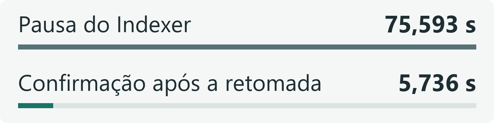

# Raphael Guterres

**Analista de cibersegurança · SOC e Blue Team**

Em laboratório, escrevo regras Wazuh para Windows, investigo eventos de Windows e Linux e confiro se os alertas chegam ao SIEM com os dados necessários para a triagem.

[LinkedIn](https://www.linkedin.com/in/raphaelguterres/)

## Projetos selecionados

**[Threat Hunting & Detection Lab](https://github.com/raphaelguterres/threat-hunting-detection-lab)** 
Investiguei **três hipóteses** com eventos de laboratório e usei controles negativos para testar as correlações por usuário, sessão e arquivo. [Relatório das investigações](https://github.com/raphaelguterres/threat-hunting-detection-lab/blob/59eeef6/docs/m1-final-review-20261110.md)

**[Detection Engineering Blue Team](https://github.com/raphaelguterres/detection-engineering-blue-team)** 
Escrevi **cinco regras Wazuh** e confirmei a identidade de **seis alertas** no Manager, no Indexer e no Discover. [Regras XML](https://github.com/raphaelguterres/detection-engineering-blue-team/tree/main/rules/windows) · [Validação no SIEM](https://github.com/raphaelguterres/detection-engineering-blue-team/blob/main/docs/phase3-final-three-stage-six-event-acceptance-20261102.md)

**[AppSec na borda com Cloudflare](https://github.com/raphaelguterres/cloudflare-429-edge-lab)** 
Em homologação, conferi que o **HTTP 429** barrou o envio antes da API e que o SQLite voltou a receber gravações após a janela de bloqueio. [Evidências do reteste](https://github.com/raphaelguterres/cloudflare-429-edge-lab/blob/main/docs/evidencias.md)

**[Cloud Security Detection Lab](https://github.com/raphaelguterres/cloud-security-detection-lab)** 
Testei privilégio mínimo no S3. A mesma sessão IAM leu o objeto e teve a sobrescrita negada. [Resultado do ensaio e estado do aceite](https://github.com/raphaelguterres/cloud-security-detection-lab/blob/main/docs/VALIDACAO-IAM-S3-OHIO.md)

**[Cybersecurity Roadmap BR](https://github.com/raphaelguterres/cybersecurity-roadmap-br)** 
Mantenho trilhas gratuitas de cibersegurança em português, com laboratórios e um plano de 24 semanas. [Painel de estudos](https://raphaelguterres.github.io/cybersecurity-roadmap-br/)

## Quando o SIEM parou de indexar

Em um exercício de laboratório, uma sonda externa ao SIEM detectou a queda do Indexer enquanto duas fontes Linux continuavam emitindo eventos. Após a retomada, encontrei **os dois marcadores gerados durante a pausa** e confirmei o retorno das fontes ao estado normal.

<picture>
  <source media="(prefers-color-scheme: dark)" srcset="https://raw.githubusercontent.com/raphaelguterres/raphaelguterres/main/docs/img/tempos-indexer-escuro.png">
  
</picture>

[Investigação, medições e melhoria aplicada](docs/caso-disponibilidade-siem.md)

## Formação

- **Pós-graduação em Cibersegurança e Forense** · Em andamento
- **Defesa Cibernética** · Formação concluída

## Ferramentas na prática

- **Telemetria e busca** · Sysmon e logs nativos de Windows Server e Linux para reconstruir eventos, Wazuh e OpenSearch para investigar alertas.
- **Automação e testes** · Python, PowerShell, Docker e GitHub Actions para validar regras e repetir os testes no laboratório.
- **Segurança em nuvem** · IAM e S3 para verificar permissões, CloudFormation para provisionar e remover a infraestrutura.

[Trilha profissional](roadmaps/ROADMAP_SOC_BLUE_TEAM_PLENO_SENIOR.md) · [Andamento dos laboratórios](roadmaps/PROGRESSO.md)
